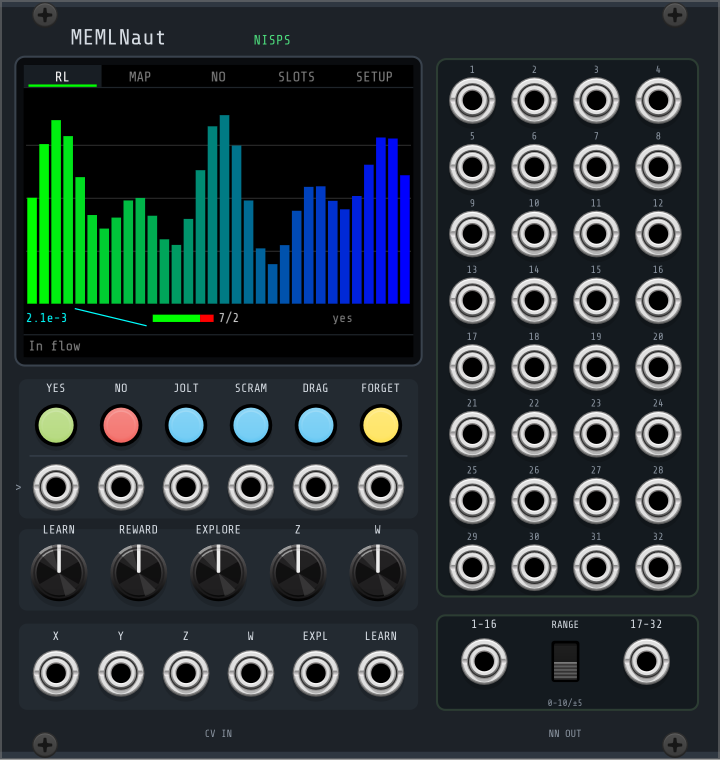

# MEMLNaut for VCV Rack

The MEMLNaut's NISPS mapper as a VCV Rack 2 module. A small neural network maps
4 inputs to 32 CV outputs, and you shape that mapping by telling it what you
like and what you don't. The engine is `NISPSCore` from `../nisps-sc` (one copy,
shared with the SuperCollider and Max ports), a port of the firmware's
`InterfaceRL`. The module's screen redraws the hardware's screens.

24 HP. The network is the firmware's: 10 inputs (the 4 you drive, the rest padded
the way the firmware pads unused inputs) → 16 → 16 → 32, ticked every 5 ms like
the hardware's 200 Hz loop. Outputs ramp between ticks so they don't step.

## Panel

| control | |
|---|---|
| **YES** | like: store the current input and sound as a liked pair (the hardware's A1) |
| **NO** | dislike; what it does is set by the dislike mode (A2) |
| **JOLT** | plant new pseudo-liked sounds in the parts of the input space you haven't taught (B2) |
| **SCRAM** | scramble the network (B1) |
| **DRAG** | hold: freeze the sound while you move the input; release: store it as a like where you let go (joystick switch) |
| **FORGET** | empty the memory |
| gate row | a trigger input under each button (≥1 V; DRAG is a gate, held while high) |
| **LEARN** | learning rate, 0 = no learning (RV Y1) |
| **REWARD** | reward scale (RV X1) |
| **EXPLORE** | exploration: the mapping drifts by itself, less near your likes (RV Z1) |
| **Z**, **W** | the 3rd and 4th inputs, when their CV jacks are empty |
| **X Y Z W** | CV inputs, 0..10 V (or −5..5 V, see the menu). X/Y override the on-screen pad |
| **EXPL**, **LEARN** | CV added to those knobs (10 V = full scale) |
| **1–32** | the network's outputs, 0..10 V or −5..5 V (**RANGE**) |
| **1-16**, **17-32** | the same outputs as two 16-channel poly cables |

## Screen

Click the tabs to change page; the mouse stands in for the touchscreen.

- **RL**: the 32 outputs as bars (green→blue, or red→yellow while exploring).
  Below them: the loss on your likes and its 12 s trace ("idle" once train-on-demand
  has settled), the yes/no split of the memory, and the last gesture, which flashes.
- **MAP**: the X/Y map, the hardware's 4D-joystick view. Drag on it to play X and Y.
  Each memory is a small triangle: green = like, red = dislike, grey = jolt point.
  Size is Z and rotation is W, and the cursor works the same way. The nearest like
  is outlined as somewhere to steer to.
- **NO**: the dislike mode. *Push away* (the original), *Nudge + blame*, *Re-roll*,
  *Nudge > back > re-roll*, *Borrow from likes*.
- **SLOTS**: 12 model slots, like the hardware's Save Model / Load Model screens.
  Pick SAVE or LOAD, then click a slot. Slots are saved in the patch.
- **SETUP**: memory mode, train on demand, CV input range (also in the right-click menu).

The footer shows the hardware's messages ("Awesome", "No: trying something new", …).

## Saving

Everything is saved in the patch (and in presets): the network's weights and
biases, the memory with each item's age, the 12 slots, and the settings.

## Building

You need the [Rack 2 SDK](https://vcvrack.com/manual/PluginDevelopmentTutorial) and a
C++20 compiler.

    make RACK_DIR=/path/to/Rack-SDK              # plugin.so / .dylib / .dll
    make RACK_DIR=/path/to/Rack-SDK install      # into your Rack user plugins folder
    make RACK_DIR=/path/to/Rack-SDK dist         # a .vcvplugin package
    make RACK_DIR=/path/to/Rack-SDK test         # host test (Linux; links the SDK's libRack)

`src/engine/` holds one-line wrappers that compile `../nisps-sc/src/*.cpp` and the
memlp sources the engine needs, so the object files stay in this plugin's
`build/` folder.

`make test` builds `tests/module_test.cpp`. It runs the module without the Rack
app: outputs and poly outs, the pad and CV override, every gesture through its
button and gate (a 1 ms trigger included), drag, explore, all five dislike modes,
slots, the patch round trip, and a CPU figure. Training runs on the audio thread
at about 1% of a core. The worst tick is a few hundred µs, against a 5 ms budget.

## Threads

The engine lives on the audio thread. The screen never touches it. It copies a
snapshot that the audio thread publishes each tick (under a `try_lock`, so audio
never waits). It writes back only through params (the pad), plain settings that
`process()` applies when they change, and a one-entry slot request. Rack itself
keeps `dataToJson`, `dataFromJson` and reset from running at the same time as
`process()`.
